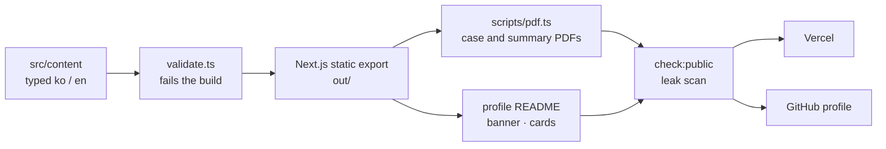

# portfolio-site

The source of [jake-jo-portfolio.vercel.app](https://jake-jo-portfolio.vercel.app): a Korean/English job-application portfolio, its PDFs and the [GitHub profile README](https://github.com/JoJakeTaemoon), all built from one typed content source.

This is the public edition of a private repository. It is exported from the private repo's `HEAD` by `scripts/public-export.sh`, which scans every file for client-identifying terms before it pushes. Client projects on the site are anonymized.

## What it does

- **Content as typed data.** Every page, PDF and the profile README read the same TypeScript objects in `src/content/` (`types.ts`): six case studies, six short briefs, the hub and the process page, in ko and en.
- **A validator that fails the build.** `src/lib/validate.ts` runs when the content loads: the ko and en versions must have the same shape and the same numbers, and it checks what the type system can't, such as caption style and the width of the process page's table cells.
- **Static export.** Next.js 16 (`output: "export"`) writes plain HTML to `out/`; client components only change presentation (folds, filters), so all content is in the HTML.
- **PDFs.** `scripts/pdf.ts` prints each page in headless Chrome under the public host name (a local server behind a throwaway certificate), so the links inside the PDFs point to the live site.
- **A leak scan before anything goes out.** `scripts/check-public.ts` reads the built HTML, Markdown and JSON, the PDFs' text and the profile drawings against a private list of client-identifying terms. It also checks that every linked PDF exists and that PDF links point only to the site. `--dir` scans this edition before each push.
- **Masked screenshots.** `scripts/mask-shots.ts` crops and downsizes local seed-data screenshots in headless Chrome and covers names and logos with opaque fills (never blur). The sources stay on the author's machine.
- **The GitHub profile README.** `src/lib/readme.ts` writes it from the same content; `src/lib/profile-svg.ts` draws its banner (light and dark SVG); `scripts/profile-assets.ts` captures each featured card's picture from the built hub over the DevTools protocol.

## Commands

| Command | What it does |
| --- | --- |
| `npm run dev` | local dev server |
| `npm test` | unit tests (`node:test`) |
| `npm run build` | static export to `out/` |
| `npm run pdf` | PDFs into `out/pdf/` |
| `npm run profile` | profile README pictures into `out/profile/` |
| `npm run release` | code images, build, PDFs, profile pictures, then the leak scan |

## Not in this edition

- `docs/`: the project facts (each with the source repository it comes from), decisions and reviews.
- `.claude/`: the agent harness (roles such as fact extractor, content writer and publish reviewer) and the leak-term list.
- `snippets/`: the sources of the code-excerpt images.
- `public/assets/`: the design kit the pages are built on (from a third-party design skill, not redistributed here).

Because of these, `npm run build` needs the design kit, and `npm run images` and `npm run release` need the private files.

No license is granted: the code is here to be read.
